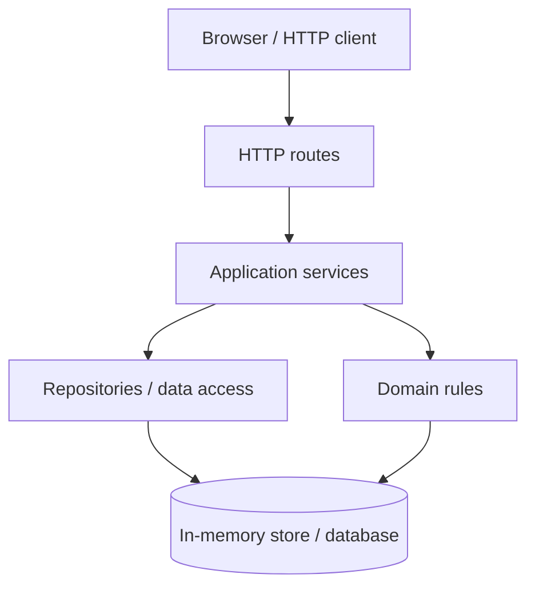
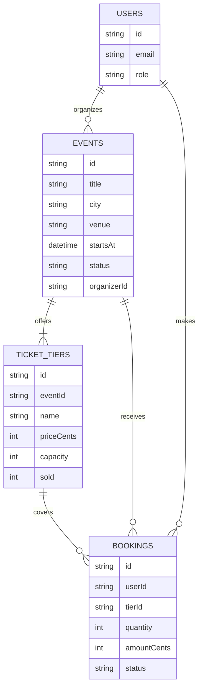
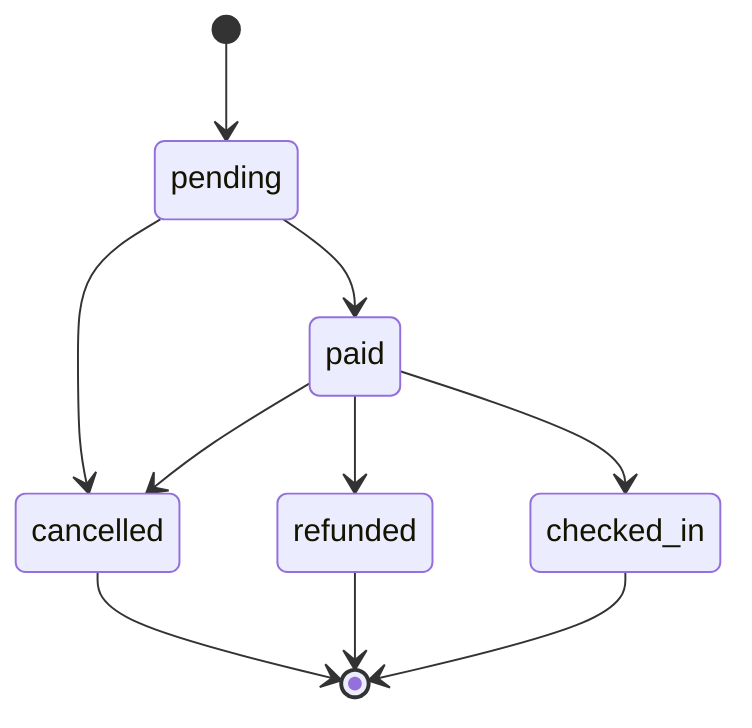

# Build 3: Architecture and booking state machine

## 1. Application layers

- **Routes / HTTP:** interpret requests, validate transport format, call services, and shape HTTP responses; they must not contain business rules or access storage directly.
- **Services:** coordinate a use case and call domain rules and repositories; they must not depend on HTTP request/response objects.
- **Domain rules:** enforce business invariants and state transitions; they must not perform network, filesystem, or HTTP work.
- **Repositories / data access:** read and write data; they must not decide business policy.
- **Data:** stores application records; it does not call other layers.

## 2. Data model

## 3. Booking life cycle

Only the transitions shown are permitted. `cancelled`, `refunded`, and `checked_in` are final states.
